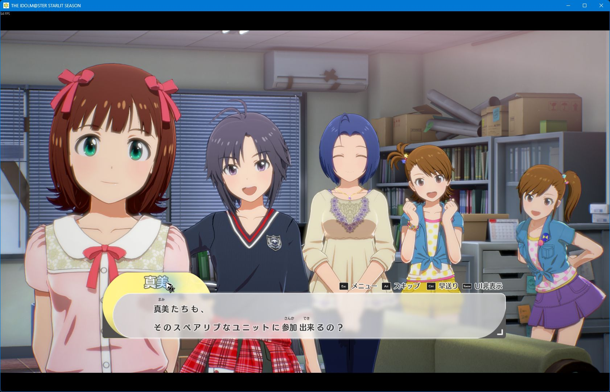

# Starlit Season Furigana

Display small kana above kanji in Japanese dialogue and answer choices in **THE IDOLM@STER STARLIT SEASON**.

For AI contributors, [AGENTS.md](AGENTS.md) records the implementation, release status, development workflow, and remaining verification work.

This is a locally tested alpha for Steam build `8278842` (game 1.61, Unreal Engine 4.24). It uses UE4SS Lua and the game's original font. **F7** toggles furigana. Readings appear after a complete matching line has finished revealing and remained stable for 250 ms.



## Download and usage

Download [v0.1.0-alpha.2](https://github.com/Indrico/starlit-seasons-furigana/releases/tag/v0.1.0-alpha.2)
and follow the [English usage guide](docs/usage.md).

Choose **`starlit-season-furigana-v0.1.0-alpha.2-windows-x64.zip`**. Extract its
contents next to `StarlitSeason.exe`, run **Check-Furigana.cmd**, and launch through
Steam. **No Python, build steps, extraction, or separate loader download are needed.**
The package includes the pinned UE4SS loader and prebuilt kana annotations.

If the mod is already installed, launch the game through Steam and press **F7**
to toggle furigana. Reinstallation is not required to use the existing setup.

## Current status

- Original Japanese dialogue was extracted locally from 163 CML DataTables: 59,361 records and 53,567 unique texts.
- The offline pipeline generated candidate readings for 258,766 of 259,130 visible kanji characters in those unique texts, approximately 99.86%.
- 362 records retain unresolved cases. Zero complete records have been manually reviewed; automatic coverage is not a reading-accuracy score.
- Ordinary dialogue, two-line font fitting, and three answer choices have been observed in the game. See [runtime verification](docs/runtime.md) for the exact checks and remaining limits.

Git contains source code, synthetic test fixtures, and documentation. The release
ZIP bundles UE4SS with its license and an annotation-only table of source hashes,
positions, and kana. Game archives, original dialogue, private reading tables,
encryption keys, saves, and analysis dumps remain local.

## Set up the reading tools

Python 3.10 on Windows was used for the local build. From the repository root:

```powershell
python -m venv .venv
& '.\.venv\Scripts\python.exe' -m pip install -r requirements.txt
& '.\.venv\Scripts\python.exe' -m unittest discover -s tools/readings -v
```

Generate a small synthetic example without game data:

```powershell
& '.\.venv\Scripts\python.exe' tools/readings/generate.py tools/readings/fixture.json --output .local/fixture-output
```

After obtaining an original local corpus and resolved character profiles, generate readings using the implemented CLI:

```powershell
& '.\.venv\Scripts\python.exe' tools/readings/generate.py .local/extracted/corpus/dialogue.jsonl --profiles .local/extracted/character-profiles-resolved.json --output .local/generated
```

The generator accepts a JSON array or JSONL records with `asset`, `row_id`, and `source_text`. Profile import is optional. See [the reading pipeline](docs/reading-pipeline.md) for output formats and limitations.

## Runtime scope

Japanese dialogue and answer choices retain their original wording, with kana above annotated kanji. Menus, profiles, and lyrics are outside this version's scope. Unsupported markup, substituted text without an exact source match, and layouts that cannot fit remain in the native renderer. Automatic readings can be wrong, especially names, counters, and context-dependent words.

The checker backs up and disables the known English patch and can restore it
during removal. Original executables and base PAK archives remain intact. The
Windows release asset includes the runtime; GitHub's automatic source archives
are intended for the optional developer workflow.

## Optional source-build workflow

1. Start the installed game normally through Steam and follow [asset extraction](docs/asset-extraction.md) to prepare a private Japanese corpus and character readings.
2. Generate the local reading table using [the reading pipeline](docs/reading-pipeline.md).
3. Close the game and follow [installation and removal](docs/installation.md). The installer verifies the supported game and loader hashes before changing the runtime directory.
4. Launch through Steam. Furigana starts enabled; **F7** restores the original text or enables annotations again. Readings appear after a matching line finishes revealing and remains stable for 250 ms.

See [runtime behavior and verification](docs/runtime.md) for layout, source selection, and current limitations. Use the virtual environment's Python executable for every Python command in the linked guides.

The [reverse-engineering notes](docs/reverse-engineering.md) describe the evidence, native signatures, and investigation limits. The workflow was informed by the [REA guide](https://github.com/morluto/rea).

## Source tests

```powershell
& '.\.venv\Scripts\python.exe' -m pip install -r requirements-dev.txt
& '.\.venv\Scripts\python.exe' -m unittest discover -s tools/readings -v
& '.\.venv\Scripts\python.exe' -m unittest discover -s tools/extraction -v
& '.\.venv\Scripts\python.exe' -m unittest discover -s tools -p test_install_mod.py -v
& '.\.venv\Scripts\python.exe' -m unittest discover -s tools -p test_portable_release.py -v
& '.\.venv\Scripts\python.exe' -m unittest discover -s tests -v
```

The tests use synthetic data and do not require or launch the game. In-game verification is recorded separately.

The current validation run passed 60 tests: 11 reading, 6 extraction, 11 Python
installer, 7 Windows package/helper, and 25 Lua lookup/layout/runtime-gate tests.
The prebuilt table was also checked against all 53,567 distinct local source
strings, including 49,749 entries with readings.
