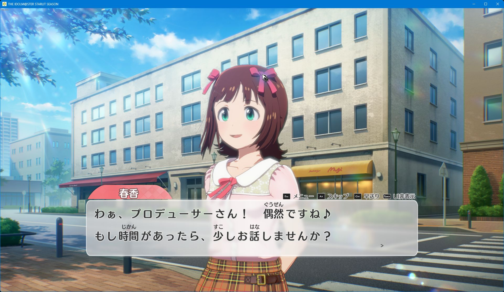

# Starlit Season Furigana

Display kana above kanji in Japanese dialogue, character names, menus, and backlog in **THE IDOLM@STER STARLIT SEASON**.

For AI contributors, [AGENTS.md](AGENTS.md) records the implementation, release status, development workflow, and remaining verification work.

This targets Steam build `8278842` (game 1.61, Unreal Engine 4.24), using UE4SS and the game's original font. The current development implementation adds manual dialogue, immediate complete furigana, and fixed font sizes. **F6** switches manual/automatic progression; **F7** toggles furigana. See [dialogue controls and preferences](docs/dialogue-controls.md).

The **v0.3.0-alpha.3** prerelease extends annotations to names, Japanese UI, and backlog while
preserving native UI fonts and widths. Menus use smaller ruby following player
feedback; names and log text retain larger readings. See [UI annotations](docs/ui-annotations.md)
for the data pipeline, layout rules, and supported fallbacks. The package also
includes manual dialogue, compact fixed dialogue fonts, an Options master switch,
and startup-logo skipping. See [performance evidence](docs/performance.md) for
sampled measurements and their limits.

Alpha.2 fixes menu-guide panels growing when furigana appears. The bottom-right
background and Enter/Esc guides now keep their native dimensions and positions.
Alpha.3 reduces delayed menu/name/log annotations through shared font metrics,
earlier preparation, fewer generated log widgets, and immediate ready-text updates.
Furigana scanning and preparation pause automatically during MV/live performances
and resume after leaving them, without changing your saved settings. Cold UI
geometry can still delay a new annotation; zero-frame pop-in is not guaranteed.



## Download and usage

Download [v0.3.0-alpha.3](https://github.com/Indrico/starlit-seasons-furigana/releases/tag/v0.3.0-alpha.3)
and follow the [English usage guide](docs/usage.md).

Choose **`starlit-season-furigana-v0.3.0-alpha.3-windows-x64.zip`**. Extract its
contents next to `StarlitSeason.exe`, run **Check-Furigana.cmd**, and launch through
Steam. **No Python, build steps, extraction, or separate loader download are needed.**
The package includes the pinned UE4SS loader, native DLL, and prebuilt kana annotations.
For an upgrade, close the game and uninstall the previous managed version first.

If the mod is already installed, launch the game through Steam and press **F7**
to toggle furigana. Reinstallation is not required to use the existing setup.

## Current status

- Original dialogue from 163 CML tables is combined locally with Japanese localization and verified name aliases: 71,309 records and 62,508 distinct strings.
- The package contains 56,494 annotated entries, 160 verified exact-name aliases, and 99 calibrated name-texture bindings.
- Candidate readings cover 294,980 of 295,416 visible kanji; 467 records retain unresolved cases. Zero complete records have been manually reviewed. Coverage is not reading accuracy.
- Sampled UI and dialogue checks use a 1920 by 1080 client. See [runtime verification](docs/runtime.md) and [performance measurements](docs/performance.md) for the tested scope and remaining limits.
- Frame-time samples still include unexplained outliers. This alpha does not promise stutter-free play.

Git contains source code, synthetic test fixtures, and documentation. The release
ZIP bundles UE4SS with its license and an annotation-only table of source hashes,
positions, and kana. Game archives, original dialogue, private reading tables,
encryption keys, saves, and analysis dumps remain local.

## Set up the reading tools

Python 3.10 on Windows was used for the local build. From the repository root:

```powershell
python -m venv .venv
& '.\.venv\Scripts\python.exe' -m pip install -r requirements.txt
& '.\.venv\Scripts\python.exe' -m unittest discover -s tools/readings -v
```

Generate a small synthetic example without game data:

```powershell
& '.\.venv\Scripts\python.exe' tools/readings/generate.py tools/readings/fixture.json --output .local/fixture-output
```

After obtaining an original local corpus and resolved character profiles, generate readings using the implemented CLI:

```powershell
& '.\.venv\Scripts\python.exe' tools/readings/generate.py .local/extracted/corpus/dialogue.jsonl --profiles .local/extracted/character-profiles-resolved.json --output .local/generated
```

The generator accepts a JSON array or JSONL records with `asset`, `row_id`, and `source_text`. Profile import is optional. See [the reading pipeline](docs/reading-pipeline.md) for output formats and limitations.

## Runtime scope

Japanese dialogue, answer choices, names, menu labels, and backlog retain their
original wording, with kana above matched kanji. Native main UI fonts and widths
stay intact; log cards may gain height. Lyrics, unknown names, unresolved rich
styles/markup, unmatched substitutions, unmapped image labels, and unsupported
geometry keep native rendering. See [UI support](docs/ui-annotations.md) for the
sampled scope. Automatic readings can be wrong, especially counters and
context-dependent words.

The checker backs up and disables the known English patch and can restore it
during removal. Original executables and base PAK archives remain intact. The
Windows release asset includes the runtime; GitHub's automatic source archives
are intended for the optional developer workflow.

## Optional source-build workflow

1. Start the installed game normally through Steam and follow [asset extraction](docs/asset-extraction.md) to prepare a private Japanese corpus and character readings.
2. Generate the local reading table using [the reading pipeline](docs/reading-pipeline.md).
3. Close the game, build the [native bridge](docs/dialogue-controls.md#developer-build), and supply it to the [installer](docs/installation.md). The installer verifies the supported game and loader hashes before changing the runtime directory.
4. Launch through Steam. Dialogue starts in manual mode; **F6** toggles progression and **F7** toggles furigana. The **OPTION** menu has the persistent master switch for all mod features, also available as **F8** while Options is open.

See [runtime behavior and verification](docs/runtime.md) for layout, source selection, and current limitations. Use the virtual environment's Python executable for every Python command in the linked guides.

The [reverse-engineering notes](docs/reverse-engineering.md) describe the evidence, native signatures, and investigation limits. The workflow was informed by the [REA guide](https://github.com/morluto/rea).

## Source tests

```powershell
& '.\.venv\Scripts\python.exe' -m pip install -r requirements-dev.txt
& '.\.venv\Scripts\python.exe' -m unittest discover -s tools/readings -v
& '.\.venv\Scripts\python.exe' -m unittest discover -s tools/extraction -v
& '.\.venv\Scripts\python.exe' -m unittest discover -s tools -p test_install_mod.py -v
& '.\.venv\Scripts\python.exe' -m unittest discover -s tools -p test_portable_release.py -v
& '.\.venv\Scripts\python.exe' -m unittest discover -s tests -v
```

The tests use synthetic data and do not require or launch the game. In-game verification is recorded separately.

The current validation run passed 147 tests: 17 reading, 9 extraction, 12 Python
installer, 7 Windows package/helper, and 102 Lua runtime/layout/lifecycle tests.
The prebuilt table was also checked against all 62,508 distinct local source
strings, including 56,494 entries with readings.
