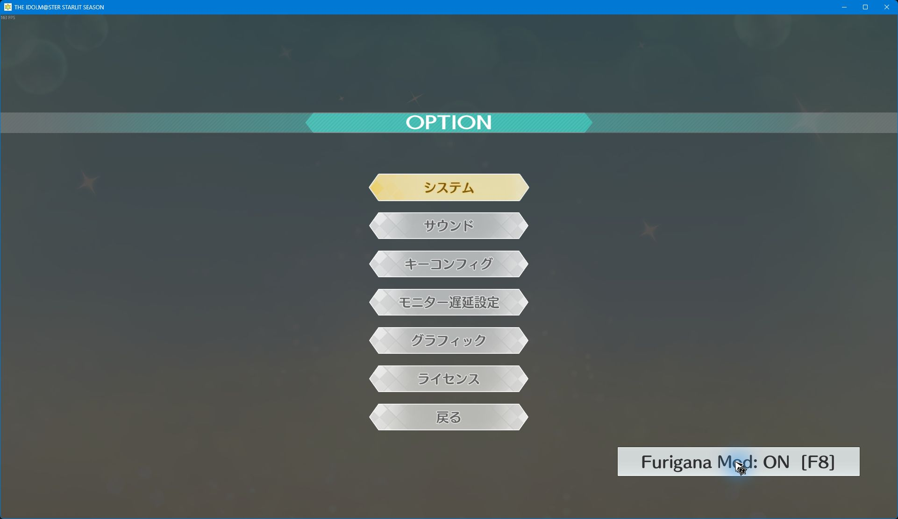

# Manual dialogue and fixed-size furigana

These dialogue controls are retained in v0.3.0-alpha.1. Name, menu, and backlog
annotations have a [separate lifecycle](ui-annotations.md). The historical
[v0.1.0-alpha.2 package](releases/v0.1.0-alpha.2.md) keeps its earlier behavior.
See [performance measurements](performance.md) for the optimized runtime.

## Controls

- Open **OPTION** and click **Furigana Mod: ON/OFF**, or press **F8** while
  that menu is open. This is the persistent master switch for every mod feature.
  Off restores native reveal/progression and disables startup skipping on the
  next launch. The menu control remains available so the mod can be enabled again.
- Dialogue waits for the normal advance input by default. Finishing the voice
  does not advance a supported line. Character animation continues.
- **F6** switches between manual and automatic progression and saves the mode.
- **F7** switches furigana off/on independently of the progression mode.
- An advance input shows the next text page when one remains. After the last
  page it reaches the game's native advance handler.
- Automatic mode reads every page before releasing the game's completion wait.
  Native completion conditions, including voice timing, still apply.

The complete line and its annotations are prepared synchronously in the native
message-assignment handler, before that handler returns to the frame loop. The
new path does not use the old 250 ms stability wait. The native reveal routine
is completed without calling the game's skip/stop-voice handlers; newline and
control units may require several reveal batches.

## Text layout

Ordinary dialogue uses a fixed base size of **29** and ruby size of **14**.
Cinema uses 30/15 and answer labels use 22/11 where their layout is supported.
These are UMG font units. Kana-only dialogue reserves the same ruby height.
Text length never reduces these sizes in the native-event path.

The ordinary dialogue window follows the native panel width (1280 local units
in the inspected layout) and uses a compact 22% of viewport height, with DPI
taken into account. Ruby is brought closer to its base by compensating for
the font's extra line metrics. The original name and control guide move with
the window; the name's decorative curl is clipped to its header bounds so it
cannot cover the words. NPC portraits receive a reserved text margin.
Overflow becomes additional pages at the
same font size, with a page indicator; ruby groups remain intact. Answer
options remain separate native buttons, and generated text ignores hit tests.

F7 and scene cleanup restore the original text opacity, background opacity,
cursor visibility/opacity, name clipping, blur bounds, and changed slot positions. Unsupported markup/layouts keep
the native renderer. Missing or rejected native hooks use the older renderer
without manual-mode support; check `ue4ss/UE4SS.log` for the reason.

## Preferences

Preferences live next to the game launcher, outside checksum-protected runtime
files, at `StarlitFurigana/user-settings.ini`. F6 and the Options control update this file.
To change reading timing, close the game and edit:

```ini
enabled = true
manual = true
auto_min_seconds = 3.000
auto_characters_per_second = 8.000
```

Page duration is `max(auto_min_seconds, base_character_count /
auto_characters_per_second)`. Whitespace does not contribute to the count.
The two numeric settings accept values from 1 to 60. Invalid/missing values use
the defaults above. The file is parsed as data and is never executed as Lua.
Installation/removal preserves this preference file.

## Developer build

Use installed MSVC x64 C++ tools and the Windows SDK:

```powershell
python tools/build_native.py --output .local/build/StarlitFuriganaNative.dll
python tools/install_mod.py --game 'D:\SteamLibrary\steamapps\common\StarlitSeason' --loader-zip .local/ue4ss.zip --readings .local/generated/readings.lua --native-dll .local/build/StarlitFuriganaNative.dll
```

The DLL uses a static C/C++ runtime and bundled MinHook sources. It checks the
supported Shipping executable hash and live function prefixes before enabling
hooks. No executable or archive on disk is patched. See
[native implementation notes](../native/README.md).

The portable packager requires `--native-dll`; the player ZIP includes the
already compiled bridge and both third-party licenses. A maintainer needs the
private reading input and pinned loader:

```powershell
python tools/build_release.py --loader-zip .local/ue4ss.zip --readings-json .local/generated/readings.json --native-dll .local/build/StarlitFuriganaNative.dll --output .local/starlit-season-furigana-v0.2.0-alpha.1-windows-x64.zip
```

The package contains 22 runtime files and five helper files. Keep published
historical ZIPs and tags immutable. See the
[release notes](releases/v0.2.0-alpha.1.md) for checksums and tested scope.

## Verification scope

See [runtime verification](runtime.md) for the actual in-game evidence. The
automated suites contain 93 tests: 57 Lua integration/layout/lookup/controller/menu/performance
tests, 12 Python installer tests, seven Windows portable tests, 11 reading
tests, and six extraction tests. Tests use synthetic fixtures and establish
neither full-game compatibility nor a frame-time improvement.


