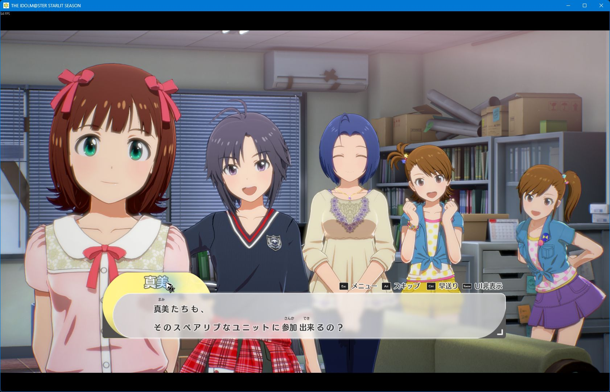
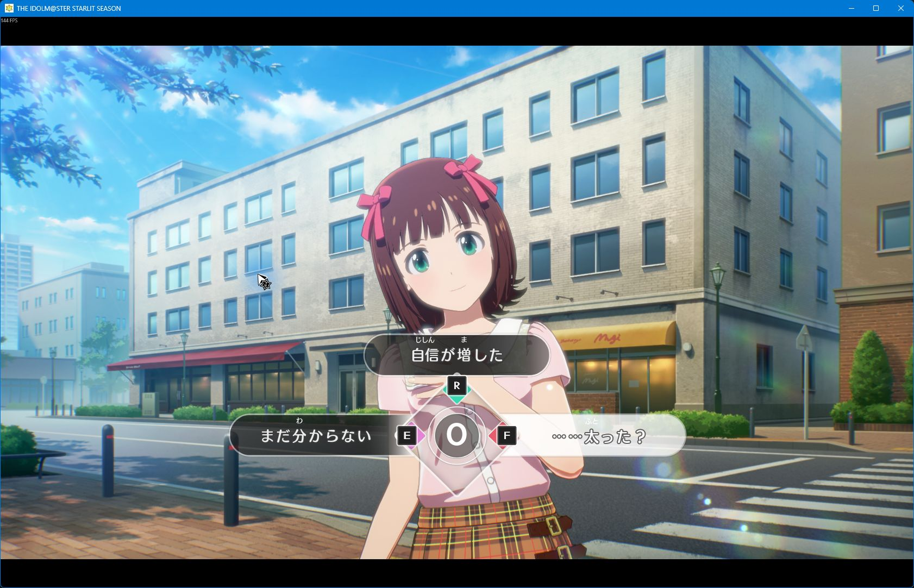

# Runtime behavior and verification

The runtime uses UE4SS Lua and the game's original UMG font. It adds separate
small kana TextBlocks above annotated words in eligible Japanese conversation
text. It does not modify the executable or save files.

## Source selection and native text reveal

Only live `/Engine/Transient` instances of the named dialogue, monologue,
cinema, novel-text, and selection text widgets are considered. Blueprint
templates, character name labels, control guides, and mod-generated TextBlocks
are excluded. The current widget text must exactly match a generated original
Japanese source entry that contains at least one reading.

Runtime observation confirmed that dialogue text grows as a prefix during the
native typewriter effect. The integration keeps the original renderer visible
while the text changes. Furigana is applied only when an exact matching source
remains unchanged across two successive 250 ms polls. A source-text change removes
the previous annotation and restores native rendering before the next wait.
Consequently, readings normally appear after a completed line, rather than
progressively above individual characters during the typewriter animation.

Furigana starts enabled. **F7** disables it, restores original opacity, and
detaches generated canvases. F7 enables it again. Disable furigana before
reloading Lua scripts; reloading an active renderer without first disabling it
has not been verified. Restarting the game clears runtime widgets.

## Layout

The adapter supports a direct `CanvasPanelSlot` or a text widget that is the
only child of a VerticalBox whose slot is a CanvasPanelSlot. It creates a sibling
CanvasPanel and copies the anchor slot's anchors, alignment, position, size,
render transform, and pivot. For a single-text VerticalBox, a second inner
canvas preserves the text's padding, vertical alignment, and render transform.
This avoids passing opaque `FGeometry` values
through UE4SS: that path returned zero-size geometry in the tested game build.
The observed ordinary dialogue slot is 960 by 116 local units, centered in its
parent; layout uses the actual slot values rather than hard-coding that size.

TextBlock measurement provides glyph widths and heights. Ruby is centered over
its base word; explicit line breaks, source margins, and left/center/right
justification are preserved. Annotated word groups wrap together. The layout
includes basic Japanese punctuation restrictions and treats supplementary
Unicode characters as one codepoint.

The font-fitting loop starts at the source font size and decreases by one point
until both base text and kana fit the source rectangle, stopping at 18 points
(or the original size when already smaller). Kana uses approximately 48% of the
base size, with an eight-point minimum. Generated text is clipped to that
rectangle. If readable text cannot fit, the original text remains visible.
Base text preserves the original outline; kana omits that thick outline for
legibility at small sizes. Font measurements are cached separately for base and
kana roles. Fit diagnostics include the chosen sizes, line count, required and
available heights, and measured glyph heights.
Ordinary dialogue may add up to four local units of height to accommodate pixel
rounding, keeping the original top edge and clipping enabled. Other widget
families do not receive that extra height. Explicit CR/LF units never enter font
measurement, so line breaks cannot pollute cached single-line glyph heights.

For table-backed rich text, the original `FONT-JP` font with face `Text` is
resolved explicitly. Default dialogue style uses size 29; cinema style uses 30.
These values were read from the installed original style tables. Plain
TextBlocks retain their own font and color. Generated widgets are
`HitTestInvisible`, so they do not take over choice-button input.

Other nested panel layouts and rich-text markup such as `<pop_G>` are
currently rejected without hiding the original text. Unsupported cases are
logged once per source. They must not be counted as successfully annotated.
Hidden generated canvases, unused pooled TextBlocks, and the idle measurement
TextBlock are collapsed, so they do not participate in layout.

## Standalone tests

From the repository root, install the development requirements and run:

```powershell
python -m pip install -r requirements-dev.txt
python -m unittest discover -s tests -p 'test_*.py'
```

There are 18 standalone tests: ten exercise ruby positioning, justification,
Unicode, line breaks, punctuation, and stable partial-word layout; eight exercise
source selection and the exact-source stability gate. They verify that changing
text removes the old annotation, unchanged text does not repaint repeatedly,
and disabling the mod detaches generated renderers.

These tests use Lua 5.4 through `lupa==2.6`. The runtime-gate tests use a simulated
UMG adapter; they establish control-flow behavior rather than real-game
rendering, timing, input compatibility, or crash safety.

## Local visual verification

On 2026-11-03, the supported Steam build was tested in a 1680 by 1050 window:

- Main Story replay dialogue displayed kana above kanji using the original font.
- Haruka's first Kizuna replay displayed one-line and fitted two-line dialogue.
- All three answer labels displayed aligned kana inside their original choice plates.
- Native typewriter text remained visible during reveal. Successive lines and scene changes removed the previous annotation during the observed replays.
- F7 restored native text and enabled annotation again. The game then closed normally with Alt+F4.
- After a clean managed installation, Steam launch and the same dialogue/choice rendering worked without the development probe or bundled sample mods.





The Album replay showed a zero timer and a highlighted right-hand answer. A
keyboard and a mouse attempt did not demonstrate a changed branch, so these
replays establish choice rendering but do not certify interactive choice input.
The generated canvases use `HitTestInvisible`; a normal-play input test remains
open.

These are sampled checks, not a complete playthrough. Interactive choice and
controller input, every conversation family (cinema/novel/DLC), every choice layout, prolonged sessions,
and every skip/auto-advance transition still require broader testing. A source
match or log message alone does not establish correct visual rendering.

A separate 1920 by 1080 launch was attempted through Steam arguments and a
temporary game configuration. The game clamped its window back to 1680 by 1050
on this display; therefore a true 1080p visual result is not claimed.
